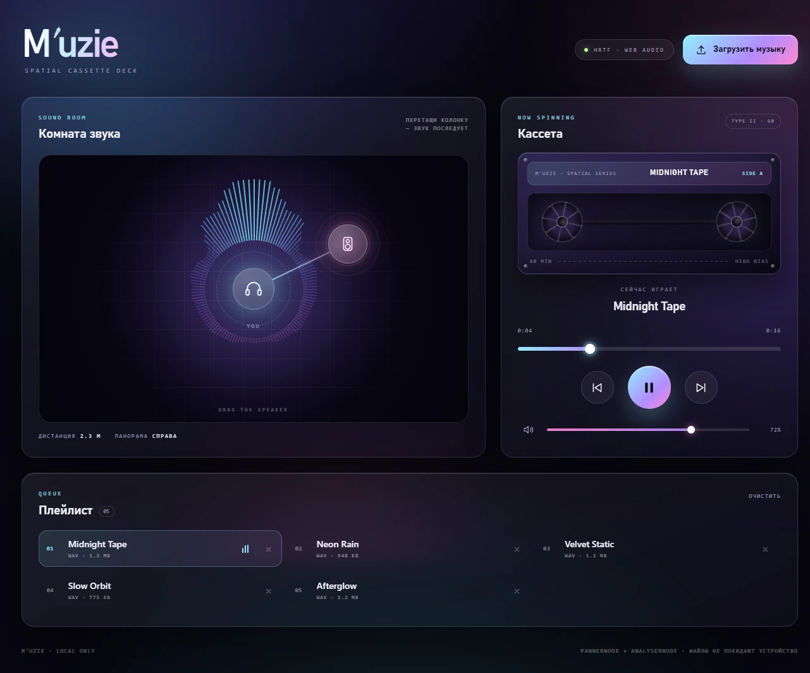

# M'uzie — облачный кассетный плеер

Локальный музыкальный плеер, который выглядит как тёплая кассета из облачного
сна: мягкая пастель, бумажный лейбл, стеклянные панели и дрейфующие облака. При
этом он звучит как настоящая комната: колонку можно перетаскивать мышкой, и звук
честно следует за ней — уходит влево, вправо, вдаль и становится глуше.

Чистый HTML5, CSS3 и Vanilla JavaScript. Никаких библиотек, CDN, сборки и
загрузки файлов на сервер: музыка остаётся на устройстве.

[](https://fuzieswagger.github.io/vibeplayer/)
[](https://github.com/FuzieSwagger/vibeplayer/releases)
[](#)
[](#)
[](#)
[](#)
[](LICENSE)

[**Открыть демо →**](https://fuzieswagger.github.io/vibeplayer/)

[](https://fuzieswagger.github.io/vibeplayer/)

## Возможности

- **Загрузка музыки** — скрытый `<input type="file" accept="audio/*" multiple>`,
  кнопка «Загрузить музыку» и drag-and-drop по всему окну.
- **Плейлист** — название, формат и размер файла, подсветка активного трека,
  эквалайзер у играющего, удаление отдельного трека и очистка всего списка.
- **Транспорт** — play/pause, следующий и предыдущий трек, автопереход в конце
  трека.
- **Прогресс-бар** — кастомный слайдер с текущим временем и длительностью:
  клик или перетаскивание меняет позицию.
- **Громкость** — ползунок, mute и запоминание уровня в `localStorage`.
- **Кассета** — кремовый корпус, бумажный лейбл, четыре винта и окно с плёнкой:
  при воспроизведении катушки крутятся, а количество плёнки на них следует за
  прогрессом трека.
- **Комната звука** — вид сверху, слушатель в центре, колонку можно тащить
  мышкой, пальцем или стрелками клавиатуры.
- **Живой визуализатор** — мягкая радиальная роза на Canvas: тёплое ядро,
  пастельные лучи и реальный спектр через `AnalyserNode`.
- **Обработка ошибок** — не-аудио файлы, битые файлы, заблокированный автоплей и
  отсутствие Web Audio не ломают интерфейс.

## Как работает пространственный звук

Аудиограф собирается один раз при первом воспроизведении:

```
<audio> → MediaElementSource → PannerNode (HRTF)
        → BiquadFilter (lowpass) → GainNode → AnalyserNode → destination
```

- **Панорама.** `PannerNode` с моделью `HRTF` получает координаты колонки.
  Слушатель стоит в центре комнаты, поэтому смещение влево/вправо даёт разницу
  между ушами.
- **Расстояние.** Комната — 9 × 7 метров. Позиция колонки переводится в
  координаты `x ∈ [−4.5, 4.5]`, `z ∈ [−3.5, 3.5]`; дальше работает
  `distanceModel: "inverse"` (`refDistance: 1.5`, `rolloffFactor: 1.2`).
- **Глухость.** Одновременно с расстоянием закрывается lowpass-фильтр:

  ```js
  const falloff = Math.min(distance / 5.5, 1);
  const cutoff = 19000 * Math.pow(0.028, falloff);
  ```

  Вблизи срез почти не слышен (~19 кГц), в углу комнаты звук становится глухим
  (~500 Гц). Поэтому «отвёл колонку далеко» слышно, а не только видно.
- **Плавность.** Координаты и срез обновляются через `setTargetAtTime`, так что
  при перетаскивании нет щелчков и ступенек.

## Управление

| Действие | Результат |
| --- | --- |
| Перетащить колонку в комнате | Меняет панораму, дистанцию и тембр |
| `Space` | Play / pause |
| `←` / `→` | Перемотка на 5 секунд |
| `↑` / `↓` | Громкость ±5% |
| Стрелки на колонке | Двигают колонку по комнате |
| `Home` на колонке | Возвращает колонку в центр |
| Клик по треку | Воспроизвести его |
| `×` у трека | Удалить трек из плейлиста |
| «Очистить» | Очистить плейлист |

## Технологии

- **HTML5 Audio** — `MediaElementSource`, `timeupdate`, `loadedmetadata`,
  `ended`, `error`.
- **Web Audio API** — `PannerNode`, `BiquadFilterNode`, `GainNode`,
  `AnalyserNode`, `AudioContext`.
- **Canvas 2D** — радиальный спектр с зеркальной раскладкой, общим пастельным
  градиентом и адаптацией под срез фильтра.
- **CSS3** — `backdrop-filter: blur(15px)`, кастомные свойства, Grid/Flexbox,
  дрейфующие облака, искры, анимации катушек и волн, `prefers-reduced-motion`.
- **Vanilla JavaScript (ES6+)** — состояние, события, pointer capture,
  `URL.createObjectURL`, `localStorage`.

Ключевые функции в `script.js`: `initPlayer()`, `playTrack()`, `togglePlay()`,
`updateProgress()`, `initVisualizer()`, а также `initRoom()` и `updateSpatial()`
для пространственной сцены.

## Структура проекта

```
.
├── assets/
│   ├── favicon.svg   # иконка сайта и источник иконки приложения
│   ├── icon.ico      # иконка Windows-приложения (16–256 px)
│   ├── og.png        # превью для соцсетей 1200×630
│   └── preview.webp  # превью для README
├── electron/
│   ├── main.cjs      # окно Electron, single-instance, состояние окна
│   └── preload.cjs   # пути файлов и хранилище плейлиста
├── scripts/
│   ├── make-icon.cjs # SVG → PNG → ICO без сторонних библиотек
│   └── build.cjs     # portable-сборка Windows и патч иконки exe
├── index.html        # разметка комнаты, кассеты и плейлиста
├── style.css         # пастель, облака, стекло, кассета, адаптив
├── script.js         # Web Audio, плейлист, drag & drop, визуализатор
├── package.json      # Electron-обёртка и скрипты сборки
├── LICENSE           # MIT
└── README.md
```

## Запуск локально

Откройте `index.html` в браузере — сборка не нужна. Для проверки drag-and-drop и
Web Audio удобнее локальный сервер:

```bash
python -m http.server 8000
# или
npx serve .
```

Затем откройте `http://localhost:8000`.

> Браузеры запускают `AudioContext` только после действия пользователя, поэтому
> первый трек начинает играть после клика по кнопке play или по треку.

## Windows-приложение

Веб-версия остаётся основным интерфейсом, а Electron-обёртка запускает её в
отдельном окне без адресной строки и вкладок. Приложение работает офлайн,
читает музыку с диска через системный диалог и drag-and-drop, а `localStorage`
и Web Audio ведут себя так же, как в браузере.

Плейлист сохраняется между запусками: пути к файлам и последний выбранный трек
лежат в `%APPDATA%\M'uzie\playlist.json`. Сами аудиофайлы никуда не копируются.
Если файл переместить или удалить, запись останется в списке с пометкой «файл не
найден». В браузере плейлист по-прежнему живёт только до перезагрузки страницы.

Готовое приложение установлено в профиль пользователя:

```
%LOCALAPPDATA%\Programs\Muzie\Muzie.exe
```

Ярлыки «M'uzie» созданы на рабочем столе и в меню «Пуск». Рядом с exe лежит
`resources/app.asar` — та же веб-версия, упакованная для запуска через `file://`.

### Сборка

Нужен Node.js 22.12+ и Windows x64.

```bash
npm install          # Electron и утилита rcedit
npm start            # запуск из исходников
npm run icon         # пересобрать assets/icon.ico из favicon.svg
npm run package      # portable-сборка в dist/Muzie-win32-x64
```

`npm run package` копирует Electron, упаковывает сайт в `app.asar` и вшивает
иконку и версию в `Muzie.exe`. Папку `dist` можно переносить целиком; ярлык
должен указывать на `Muzie.exe` внутри неё. `node_modules`, `dist` и временная
папка `build` в репозиторий не попадают.

## Поддержка браузеров

Нужен браузер с Web Audio API: Chrome, Edge, Firefox, Safari. Если Web Audio
недоступен или контекст не удалось создать, плеер продолжает работать в обычном
стерео, а в комнате появляется предупреждение.

Форматы (MP3, WAV, OGG, FLAC, M4A, AAC) зависят от браузера: файл выбирается по
`accept="audio/*"`, а неподдерживаемый кодек покажет понятный тост вместо
молчаливого отказа.

## Приватность

Файлы не загружаются никуда: используются только локальные `file://` и
`blob:`-ссылки, а также локальный аудиограф. Нет запросов, аналитики, cookies и
внешних шрифтов. В веб-версии в `localStorage` хранится только уровень
громкости; desktop-версия дополнительно хранит список путей к музыке в
`%APPDATA%\M'uzie\playlist.json`.

## Дизайн

| Токен | Значение | Назначение |
| --- | --- | --- |
| `--paper` | `#fbf6f0` | тёплая бумажная основа |
| `--paper-deep` | `#f4ebe6` | бумажные тени |
| `--ink` | `#352c48` | основной текст |
| `--ink-soft` | `#5f5372` | вторичный текст |
| `--peach` | `#ffd9c6` | тёплое свечение комнаты |
| `--rose` | `#ffc9da` | акцент, обложка кассеты |
| `--lilac` | `#d9cdf7` | прохладный акцент |
| `--sky` | `#c9e7f8` | нижняя часть неба |
| `--gold` | `#d9a86a` | апостроф, искры, детали |
| `--radius` | `28px` | скругления панелей |

Фон — тёплый градиент от персика к лилии и небу, поверх него дрейфуют пять
размытых облаков, мерцают искры и лежит очень лёгкое бумажное зерно. Панели
стеклянные (`backdrop-filter: blur(15px) saturate(120%)`), заголовки — серифные,
а кассета собрана из кремового корпуса, бумажного лейбла, четырёх винтов и окна с
плёнкой: количество плёнки на катушках привязано к прогрессу через
`--tape-left` / `--tape-right`. На экранах ≤1024px интерфейс перестраивается в
одну колонку, на ≤720px — в компактный мобильный вид.

## Авторы

- **fuzie** ([FuzieSwagger](https://github.com/FuzieSwagger)) — идея, дизайн,
  разработка.

## Лицензия

[MIT](LICENSE) © 2026 fuzie
